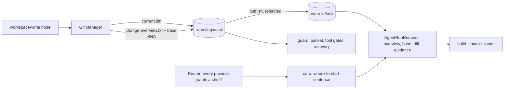

# Design — Agent diff hand-off

Satisfies [requirements.md](requirements.md); tells the story of [happy-path.md](happy-path.md) in code.

## Overview

Every time the core writes `current.diff` after an editing node, the Git Manager also writes a **change overview** from the same snapshot: the resolved base SHA, one line per changed path (kind, `+added −removed`, a denied-path mark) and the totals, bounded in size. The node runner publishes it to the exchange beside the diff and stores its path and the base SHA in `NodeInputs`. Every later agent and evaluator request carries both, and a short **where-to-start sentence** built in the core: a node whose every possible provider grants a shell is told to start from the overview and inspect files against the base; any other node is told to read the full diff with the overview as its map. The footer renders the new entries next to the existing ones. Nothing else moves: `current.diff` is written exactly as today and every core reader keeps reading it.

## Key decisions

### D-1 — The overview is a sidecar written with the diff, not derived later

**Context.** FR-5 needs the overview, the base and the diff to describe one moment; NFR-3 needs a resumed task to hand a node the same overview a fresh run did. The base SHA and the "since the last orchestrator commit" scope are not recoverable from the diff text alone.

**We will** have the Git Manager write `.worc/logs/<task-id>/change-overview.txt` immediately after `current.diff`, inside the same call, from the diff text it just produced plus two facts it already owns (the resolved base, the gate reference). Recovery republishes the private copy the same way it republishes `current.diff` today.

**Rejected:** deriving the overview in the node runner from the published diff — it would have to ask git for the base separately (a second moment) and recovery would recompute it from a working tree that may have moved; computing it lazily per node — breaks NFR-3 for the same reason.

### D-2 — One parser for "what a diff touched"

**Context.** `supervisor_packet.summarize_diff` already parses `current.diff` into paths and totals for the PR body. A second parser for the overview would let the two disagree about the same change.

**We will** move the parsing into one pure, stdlib-only module at the package root (`src/wastech_orchestrator/diff_overview.py`, alongside `globmatch.py`), extended to per-file entries (kind from the `new file mode` / `deleted file mode` / `rename from` headers, per-file `+`/`−` counts). `summarize_diff` becomes a fold over those entries; the Git Manager renders the overview from them. The root placement keeps both `git_manager.py` and `core/` able to import it without crossing an import-linter contract.

### D-3 — The guidance is chosen for the most restrictive provider on the route

**Context.** `AgentRouter.route_grants_shell` answers "may this attempt get a shell on **any** provider it may land on", fail-closed toward **yes**, because it decides whether to take a detection fingerprint. FR-4 needs the opposite question and the opposite default: a node must never be told to run a command it may not be able to run. The router's own fallback keeps the prompt text and replaces only `diff_path` (`routing/router.py`, `_build_request`), so guidance cannot be re-chosen per attempt without teaching the router core text.

**We will** add a sibling `every_provider_grants_shell` in `security/shell_reach.py` — true only when **every** provider on the route has a config, a bound check, and a check that says yes; anything unknown is false — and a router method `route_always_grants_shell` over it. The core picks the shell sentence only when it returns true. This resolves Q-5: one choice per request, valid for whichever provider ends up serving it.

**Rejected:** reusing `route_grants_shell` (wrong default for this question); rebuilding the guidance on fallback (the router would need core-built text or the core's rules).

### D-4 — The guidance is a core-built line carried on the request

**Context.** A role prompt cannot branch on capability — the renderer substitutes paths and metadata, it has no condition on a fact like "has a shell". The security preamble and the skills block already set the pattern: text built once in the core, carried on `AgentRunRequest`, placed by the one neutral seam `build_effective_prompt`.

**We will** add `change_overview_path: str | None`, `diff_base: str | None` and `change_guidance: str | None` to `AgentRunRequest`. `build_context_footer` lists `- change overview: <path>` before `- diff: <path>`, then a `Change base: <sha>` line, then the guidance sentence. The sentence itself is produced by a pure function in `core/flow/change_guidance.py` from `(has_shell, decomposed)`; it names only `git` verbs, which the core already owns through the Git Manager, never a provider tool or flag. Every flow — packaged or operator-authored — gets it without a prompt change.

### D-5 — Decomposed runs carry both scopes side by side (resolves Q-1, proposed)

**Context.** In a decomposed run `current.diff` keeps every subtask (whole-task scope), while the dangerous-diff guard measures from the gate reference — the orchestrator's last commit for the task, which inside `decomposition.sub_flow` is the previous subtask's commit. A subtask reviewer needs the second scope; `documentation` after the region needs the first.

**We will** always write the whole-task section (it is what `current.diff` holds, so FR-5 holds for it), and add a second section — `Since the orchestrator's last commit <sha>` with its own per-path lines — whenever the gate reference differs from the base. Paths come from `changed_code_entries` and counts from `git diff --numstat <gate-ref>` plus the untracked list, computed in the same Git Manager call. The packaged `review` prompt's existing subtask block says to judge the second section; `documentation` is told nothing new and uses the first. No node is hidden either scope.

### D-6 — The footer is uniform; the prompts decide emphasis (resolves Q-2, proposed)

**Context.** `fixing` and `documentation` resume the implementation session and read the full diff in 33/50 and 50/50 runs. The footer is a handful of lines; the cost is in what the prompt sends them to read.

**We will** give every node the same footer entries and change the packaged prompts instead: `fixing` / `fixing.continue` start from the review findings and the failed check log, use the overview only to locate files, and open the full diff only when a finding cannot be placed without it; `documentation` works from the overview and the per-file diffs of what it documents. The uniform footer keeps one rule for every flow and leaves operator-authored prompts working unchanged.

### D-7 — A partial diff on fallback drops the overview for that attempt

**Context.** After an infrastructure failure that changed files, the router hands the fallback attempt a partial diff (`PartialChange.diff_path`, `git diff HEAD`) in place of `diff_path`. The overview then describes a different change than the diff beside it.

**We will** have the router clear `change_overview_path`, `diff_base` and `change_guidance` whenever it substitutes a partial diff, so that attempt sees exactly today's hand-off. The router learns no core text; it only sets three fields to `None`. This is rare (infra failure plus a changed tree) and keeps FR-5 true by construction.

### D-8 — Bounds (resolves Q-4)

The overview lists at most **200 paths per section**; beyond that it ends the section with `… and N more paths (+A −R) not listed` so the totals stay exact. With repository-relative paths that keeps the file under roughly 20 KB in the worst case — against a measured p90 diff of 684 KB in the largest repository. The constant lives in `diff_overview.py`, not in config (out-of-scope: no knob).

## Layers touched

| Layer | What changes |
| --- | --- |
| `diff_overview.py` (new, package root) | Pure per-file parser of a unified diff (`DiffEntry`: path, previous path, kind, added, removed); the overview renderer with the D-8 bound; no I/O, stdlib only. |
| `git_manager.py` | `write_current_diff` also writes `change-overview.txt` (D-1, D-5): resolves `_diff_base()` to a full SHA with `rev-parse`, renders the whole-task section from the diff text it just wrote, adds the since-last-commit section when `gate_reference` differs, marks paths matching `security.denied_read_paths`, redacts like the diff. Returns both paths and the SHA in a small result type. |
| `core/flow/nodes/base.py` | `NodeInputs` gains `change_overview_path` and `diff_base`; the git protocol's `write_current_diff` returns the new result type. |
| `core/flow/nodes/agent.py` | `_apply_post_edit_guard` and `_reconsider` publish the overview beside the diff and set both inputs; `_build_request` fills the three request fields, choosing guidance via the router (D-3). |
| `core/flow/nodes/evaluator.py` | `_build_request` fills the same three fields the same way. |
| `core/flow/change_guidance.py` (new) | The where-to-start sentence as a pure function of `(has_shell, decomposed)`. |
| `core/flow/context_paths.py`, `core/prompts.py`, `core/flow/prompt_vars.py` | `change_overview_path` and `diff_base` join the path context and the allowlist (FR-9); a `tool` node's stdin `paths` gains the overview path. |
| `core/orchestrator.py` | `_restore_engine_inputs` republishes the private overview and restores `diff_base` from its header (NFR-3). |
| `core/supervisor_packet.py` | `summarize_diff` delegates to `diff_overview` (D-2); output unchanged. |
| `providers/base.py` | `AgentRunRequest` fields; `build_context_footer` renders them (D-4). |
| `providers/exchange.py` | `assert_orchestration_paths_contained` covers `change_overview_path`. |
| `providers/_adapter_base.py` | `request.json` `context_paths` records `change_overview_path` and `diff_base` (NFR-5). |
| `routing/router.py` | `route_always_grants_shell` (D-3); the partial-diff substitution clears the three fields (D-7). |
| `security/shell_reach.py` | `every_provider_grants_shell` beside `any_provider_grants_shell` (D-3). |
| `packaged/` | Role prompts and guide pages (see Provider & prompt surface, Doc impact). |
| `tests/` | See Tests. |

`cli.py`, `config/`, `state_store.py` and `ledger.py` do not change.

## Control flow & state

- **When it is written.** Exactly when `current.diff` is: after a `workspace-write` agent node's run (`_apply_post_edit_guard`) and after a denied-guardrail reconsider pass (`_reconsider`). Read-only nodes, `checks`, `tool`, `human_gate` and `publish` write neither.
- **Who sees it.** Every agent and evaluator request after the first write, through `NodeInputs` — the same reach `diff_path` has today. Supervisor turns are unchanged; they read the packet.
- **Statuses and transitions.** None change. A failure to write the overview is a failure of the same Git Manager call that writes the diff and surfaces the same way (NFR-3).
- **Resume.** `_restore_engine_inputs` republishes `change-overview.txt` when it exists and reads `diff_base` back from its first line; a task resumed before any edit has neither, exactly like `diff_path`.
- **Decomposition.** Each subtask's edits rewrite both files; the since-last-commit section follows the gate reference as the orchestrator commits each subtask (D-5).

## Data & stored shapes

- **New private artifact** `.worc/logs/<task-id>/change-overview.txt`, registered as artifact kind `change_overview` beside `diff`. UTF-8, `\n` newlines, written with `newline=""` semantics (bytes of the rendered text).
- **New exchange file** `.worc-io/<task-id>/change-overview.txt`, the redacted published copy.
- **Format** — plain text, the shape shown in [happy-path.md](happy-path.md): a header line `Change since <sha> (task base) — N files, +A −R, full diff <size>`, then `<kind>  <path>  +a  −r` per path (`A` / `M` / `D` / `R old → new`), `[denied]` appended to a denied path, then the optional second section with the same layout. Repository-relative POSIX paths.
- **`request.json`** — two more keys under `context_paths`.
- **Unchanged:** `config.yaml` schema, `state.db`, the flow YAML schema, task-file fields, `current.diff` itself. No migration: greenfield.

## Provider & prompt surface

- **No adapter argv changes.** The new text reaches the CLI through the existing stdin prompt, assembled by `build_effective_prompt`; nothing is added to argv, so the flag ceiling is untouched.
- **New prompt variables** `{change_overview_path}` and `{diff_base}` (FR-9), both may be empty before the first edit and are used in `{?name}…{/name}` blocks.
- **Packaged prompts rewritten** (FR-8): `implementation/review.md` (start from the overview; in its subtask block, judge the since-last-commit section), `implementation/fixing.md` and `fixing.continue.md` (D-6), `implementation/documentation.md` (overview plus per-file diffs instead of "the diff … is at `{diff_path}`").
- **Packaged prompts that keep the whole diff, now saying so:** `blog_article/tone_style.md`, `blog_article_revise/tone_style.md`, `content_chapter/story_critic.md`, `content_translate/en_critic.md` — each judges the revision as a whole and reads `{diff_path}` deliberately; one clause makes that explicit so the footer's shell sentence does not steer them away.
- **The footer sentence** (D-4), illustratively — with a shell: _"Start from the change overview. Inspect a file's change with `git diff <base> -- <path>`; open the full diff only if you need all of it. Do not inspect paths marked [denied]."_ Without: _"Read the full diff for the change; the overview lists what it contains and how large it is."_ The decomposed variant adds one clause naming the second section. The exact wording is settled in the implementing phase against the AC.

## Failure classes & routing

- No new failure class. Writing the overview is part of the post-edit Git Manager call; a git error there is what a failing `write_current_diff` is today — a Git error, which never falls back.
- A route fallback after an infrastructure failure follows D-7. The guidance chosen under D-3 is valid for the fallback provider by construction.
- An agent that ignores the guidance is not a failure: the full diff is still there (FR-3), and the review's quality is judged by the flow as today.

## Security & isolation

- **No capability change** at any value of `security.strict_isolation`: the guidance describes the shell a node already has; it grants none. The `--tools` set, the sandbox, `denied_commands` and the forbidden-args ceiling are untouched.
- **Redaction.** The overview is redacted with the same secrets as the diff (the Git Manager's `_diff_secrets` before writing, `publish_file` with `prompt_secrets` when publishing). It carries paths and counts only — no hunk content.
- **Denied paths.** A changed path matching `security.denied_read_paths` is listed with `[denied]` and the sentence tells a shell node not to inspect it (NFR-2). This narrows, never widens, what a node is pointed at; the read denies themselves are unchanged.
- **The base SHA** is not a secret; it is already in the repository the node runs in.
- **Containment.** `change_overview_path` joins `assert_orchestration_paths_contained`, so a request whose overview path is outside the exchange fails closed like any other path.

## Cross-platform

- Paths in the overview are `Path.as_posix()`, matching git's own output; the file is written as bytes with `\n`, so its content is identical on every OS.
- The shell decision already covers native Windows: a Claude `read-only` node has no shell there (its `attempt_has_shell`), so D-3 picks the no-shell sentence without a platform branch in the core.
- `git diff <base> -- <path>` in the sentence is the same on all three shells; paths with spaces are not quoted by the overview — the sentence says to quote them.

## Observability

- `request.json` records the overview path and the base under `context_paths`; the rendered prompt in `prompt-audit` shows which sentence the node received (NFR-5).
- The private overview is registered as an artifact and survives terminal cleanup like `current.diff`.
- The NFR-4 success signal is measured from the same per-run event logs the problem was measured from; no new telemetry is added for it.

## Tests

- **`diff_overview` (unit):** kinds A/M/D/R and mode-only changes; per-file counts; header lines that look like hunk lines; the 200-path bound and the exact totals line; byte-identical output for the same input; `summarize_diff` totals equal to the overview's.
- **`every_provider_grants_shell` (unit):** all yes → true; any no → false; a missing config or check → false; contrast with `any_provider_grants_shell` on the same inputs.
- **Git Manager (temp-repo):** the overview and `current.diff` agree on the path set, including an untracked new file and an excluded `.worc/` path; the base line is a full SHA in `new` and `existing` modes; the second section appears only after an orchestrator commit and lists only post-commit paths; a denied path is marked; a secret value in a path is redacted.
- **Node runners:** after a workspace-write node, the next request carries all three fields; before any edit, none; a Claude read-only route gets the no-shell sentence, a Codex route the shell sentence, a mixed primary/fallback route the no-shell sentence.
- **Router:** a partial-diff substitution clears the three fields.
- **Footer / effective prompt:** order and exact rendering; a request with none of the new fields renders today's footer byte-for-byte.
- **Recovery:** a resumed review gets the same overview path content and `diff_base` as the fresh run.
- **Fake-CLI integration:** one `implementation` run through `review` with the fake Claude CLI, asserting the prompt it received.
- **Cross-platform:** the overview bytes are identical under a Windows-style path fixture; the native-Windows shell answer drives the no-shell sentence.

## Doc impact

- **On this branch:** `packaged/guide/flows/prompt-variables.md` (two new variables, when they are empty), `packaged/guide/flows/roles.md` (what a role is handed about the change, and the where-to-start sentence), the packaged role prompts listed above. `.agents/rules/` do not describe the context footer and need no change.
- **Breadcrumb for the documentation branch:** likely affects `worc_architecture.md` (the context hand-off between nodes) and `glossary.md` (change overview, diff base).

## Diagram

