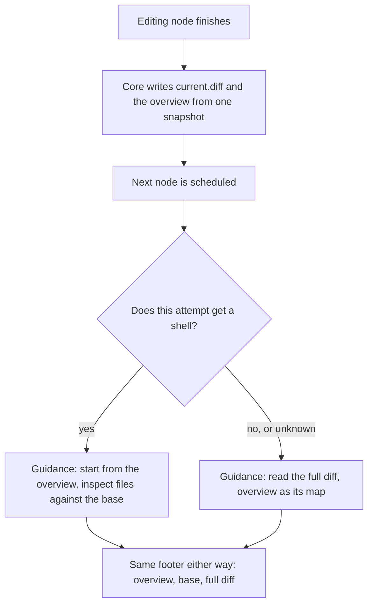
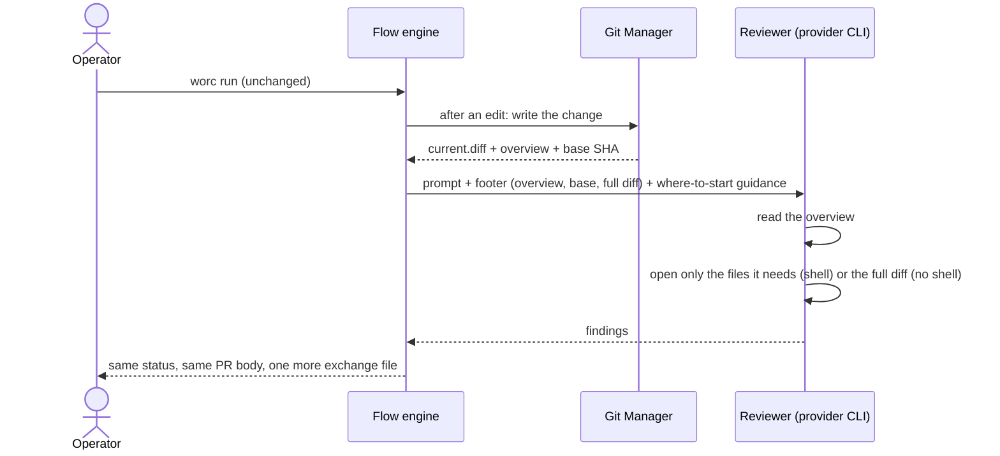

# Happy path — Agent diff hand-off

Tells the story of [requirements.md](requirements.md), inside the fence of [out-of-scope.md](out-of-scope.md). File and variable names here (`change-overview.txt`, `{diff_base}`) are the ones the design settles on.

## In one sentence

An operator who runs a task changes nothing they type, and every reviewer, fixer and documentation pass after the first edit now starts from a one-page map of what changed and the exact point it is measured from — instead of being pointed at the whole change and left to read it all, or to guess where it starts and go looking with `git` on top.

## Before / After

|  | Before (today) | After (this task) |
| --- | --- | --- |
| What the operator types | `worc run` / `worc watch` | the same — no new command, key or flag |
| What a node is handed about the change | one line: `- diff: .worc-io/<task-id>/current.diff` — the whole change since the base, 14 KB to 1.1 MB | the same line, plus `- change overview: …` (a page: which files, how, how much) and the base commit, plus one sentence on where to start |
| What a node with a shell does | reads the whole diff, then runs `git diff HEAD` / `git status` anyway (every Claude reviewer measured did both) | reads the overview, then opens only the files it needs with `git diff <base> -- <path>` |
| What a node without a shell does | reads the whole diff | the same — told so explicitly, with the overview to plan its reading |
| What lands (branch / PR / artifacts / state) | branch, PR, `current.diff` under `.worc/logs/<task-id>/` | identical — plus one more file in the agent exchange `.worc-io/<task-id>/` and one more entry in each node's `request.json` |

## Example 1 — a review on a laptop in advanced mode

The operator has a fresh install (`security.strict_isolation: false`) and a task that changes four files and adds one.

1. The operator runs `worc run`. `planning` writes the plan; `implementation` edits the clone.
2. Right after `implementation` finishes, the orchestrator writes `current.diff` exactly as today — and, from the same snapshot, the overview:

   ```text
   Change since 3f9c2a7e1d4b5a6c8e0f1a2b3c4d5e6f7a8b9c0d (task base) — 5 files, +412 −37, full diff 61 KB

   M  src/app/config/loader.py        +88  −12
   M  src/app/config/schema.py        +41   −3
   A  src/app/config/defaults.py     +120   −0   (new file)
   M  tests/test_loader.py           +156  −22
   M  README.md                        +7   −0
   ```

3. `testing` runs the checks; they pass.
4. `review` starts in a fresh session. Its footer lists the task, the plan, the overview, the base and the full diff, and its prompt says: _start from the overview; inspect what you need with `git diff <base> -- <path>`; open the full diff only if you need all of it._
5. The reviewer reads the overview, opens the three source files' diffs and the new file, skims the test diff, and returns its findings. It never loads 61 KB it did not need, and it never measured from the wrong place.
6. Rework: `fixing` changes `loader.py`. A fresh overview is written; the next `review` pass starts from it the same way.
7. `documentation` and `publish` run as today. The PR body is built from the same `current.diff` as before.

## Example 2 — the same review where the node has no shell

The operator has turned on `security.strict_isolation: true`. A read-only Claude reviewer can read files but cannot run commands.

1. Steps 1–3 as above; the same overview and the same `current.diff` are written.
2. `review` receives the same footer — task, plan, overview, base, full diff — but its guidance sentence differs: _read the full diff at `{diff_path}`; the overview lists what it contains._
3. The reviewer reads the overview to see the shape of the change, then the full diff — exactly the channel it has today, with a map in front of it. It is never told to run a command it cannot run.

The same holds when the orchestrator cannot tell whether a node will have a shell: it gets this guidance, not Example 1's.

## Example 3 — a content critic that should see everything

In a content flow, a critic judges a revised chapter as a whole: the before and the after of every paragraph matter. Its role prompt already names `{diff_path}` and now says so outright — _read the whole change_. It receives the overview too, and uses it only to see how large the change is before reading. Nothing about its behavior is lost.

## Run flow



## Before → After (sequence)



Still open and shown here only as today's behavior: what a decomposed run's nodes are told about scope (Q-1), and whether a fixer resuming its own session is pointed at the overview at all (Q-2) — see [questions.md](questions.md).
